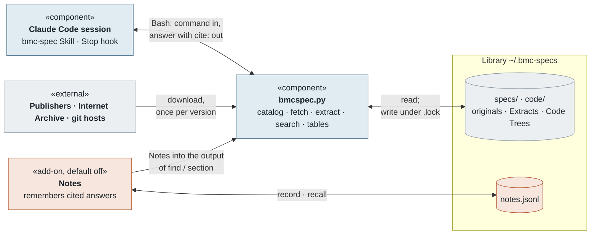
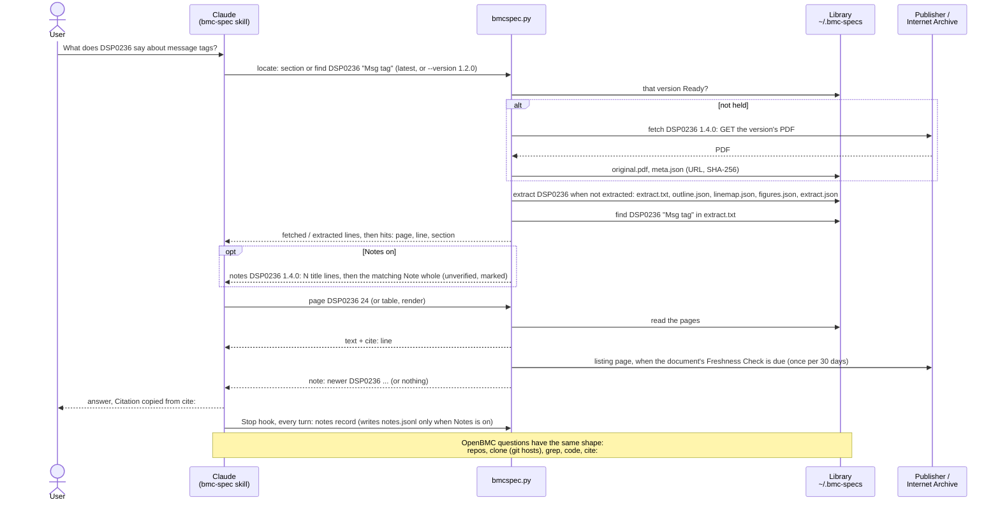

# bmc-toolkit

Claude Code plugin for BMC firmware developers. Its first skill, `bmc-spec`,
works from BMC specifications (IPMI, DMTF MCTP / PLDM / SPDM / NC-SI /
SMBIOS, Redfish, OData, NVMe, OCP DC-SCM and DC-MHS, I2C, SMBus, PMBus,
eSPI, LPC, SFF, CMIS, TCG, UEFI, ACPI, Arm server standards, NIST firmware
resiliency, IETF RFCs and more) and from OpenBMC, Aspeed and Nuvoton
source, kept in a local library of the documents and repositories you
asked about (the latest published version unless you name another). What you can ask:

- What a spec says, cited to document, version, section and page: "What
  does DSP0236 say about message tags?"
- The command line for a named Command, bytes from the spec: "Give me the
  `ipmitool raw` line for Get Device ID."
- What pasted `ipmitool`, `pldmtool` or `mctp-client` output means, the
  completion code and each field: "`ipmitool raw 0x06 0x01` printed
  `20 81 06 02 02 bf 00 00 00 00 00`; what does it say?"
- How OpenBMC, Aspeed or Nuvoton source implements something, cited to
  repository, commit and line: "Where does bmcweb set PowerState?"

**Status: 1.9.0.** The Source Catalog lists 145 documents in
37 families. The 125 open ones are downloaded by the tool and every one of
them has been checked against the acceptance questions in
`docs/golden-questions.md`; the 20 gated, member and NDA documents are
listed with their tier and registered from your own copy. Which documents,
their limits and whether each is verified: [docs/SUPPORT.md](docs/SUPPORT.md);
how the catalog is kept: [docs/CATALOG.md](docs/CATALOG.md).

What the plugin is made of and where the data flows; a double arrow reads and writes:



## Install

```
/plugin marketplace add ianmhuang/bmc-toolkit
/plugin install bmc-toolkit@bmc-toolkit
```

The same two steps from a terminal: `claude plugin marketplace add
ianmhuang/bmc-toolkit`, then `claude plugin install bmc-toolkit@bmc-toolkit`.

Requirements: Python 3.11 or newer on `PATH` as `python` or `python3`, and
`git`. A `SessionStart` hook installs the packages in `requirements.txt` into the
plugin's data directory, again only when that file changes; in a development checkout run `pip install -r requirements.txt` yourself.

- `curl_cffi` (MIT): HTTP client with a browser TLS fingerprint; without it
  Intel documents come from the Internet Archive instead of the publisher,
  OCP documents still download directly (both verified).
- `pypdfium2` 5.x (BSD-3-Clause or Apache-2.0): PDF text with character
  positions and bookmarks; older than 5.0 is refused.
- `pdfplumber` (MIT): cell geometry and cell text of tables (ruled, and
  drawn as cell boxes), for `table`; loaded only by that command.

### Updating

Claude Code offers an update when the version in `plugin.json` rises but does not update
third-party marketplaces on its own: enable auto-update for `bmc-toolkit` in `/plugin`
(Marketplaces tab), or run `claude plugin update bmc-toolkit@bmc-toolkit`. The Library
stays, and so do the installed packages unless `requirements.txt` changed; after an update
that changes the extractor, `status` marks documents `stale` and `extract --all` re-extracts them, downloading nothing.

## How a question is answered



Solid arrows are commands and Library access, dashed arrows what comes back. A reading
command brings the version it needs to Ready (held and extracted) by itself: the catalog's
latest, or the one `--version` names. The publisher is contacted only when the Library
lacks the version, and once per document per 30 days to ask whether it lists a newer one
(reported, never downloaded). The skill copies its Citation from the `cite:` line of every
printed page (a Markdown or plain-text document is cited by its file's line numbers).
What each command does: [docs/COMMANDS.md](docs/COMMANDS.md).

A named Command gets an Invocation: IPMI as `ipmitool raw`; MCTP control, PLDM
(`pldmtool raw` too, plus the subcommand its source defines) and SPDM requests without
cryptography as `mctp-client`; NC-SI as `ncsi-cmd` and the whole packet for `mctp-client`;
NVMe-MI as the whole message with its MIC, plus `nvme admin-passthru` for Admin Commands;
OEM Commands no Document defines get none. Missing values are `<placeholders>`. The model picks the fields: check them against the cited layout. None was run against hardware or QEMU.

## Library location

Documents and code checkouts live under `~/.bmc-specs/` by default; set
`BMC_SPEC_LIBRARY` to move it. Every project on the machine shares the path.
Documents sit at `specs/<family>/<document>/<version>/`, Code Trees at
`code/<repo>/<commit>/`; what each holds: [docs/LIBRARY.md](docs/LIBRARY.md).

## Command line

The skill drives `skills/bmc-spec/scripts/bmcspec.py`; you can too, here through a shell alias:

```
alias bmcspec='python skills/bmc-spec/scripts/bmcspec.py'

bmcspec catalog              # every document, one per line
bmcspec fetch DSP0236 --version 1.2.0   # without --version: the latest published version
bmcspec find DSP0236 "Msg tag" --context 1   # hits with page, line, section
bmcspec table DSP0236 --page 122             # the table(s) on the page, whole
bmcspec invocation ipmi 'NetFn:1=0x06' 'Cmd:1=0x01'   # Get Device ID as ipmitool raw
bmcspec grep bmcweb CurrentPowerState --context 2
```

Exit codes, `--wait` (several conversations can share one Library), flags, output formats, `config.toml` and every command with an example: [docs/COMMANDS.md](docs/COMMANDS.md#examples).

## What the tool does on the network and on disk

- Downloads only URLs listed in the Source Catalog, the publisher's first
  and then the Internet Archive's snapshot of it; a manual document is
  never requested, and a response that is not the expected PDF, ZIP,
  Markdown or plain text is discarded. A reading command downloads the version it
  answers from when the Library lacks it (`[library] offline = true` in `config.toml` stops that).
- Writes only under the Library, replacing nothing without `--force`; from a
  Redfish ZIP bundle only the files an answer needs are unpacked.
- `check`, `refresh` and a reading command due for its Freshness Check
  read publisher listings (an RFC's rfc-editor.org JSON), `refresh` also
  GitHub's newest commit of a pinned Markdown file; none downloads.
  `refresh --write` alone writes outside the Library, into the catalog.
- Runs `notes record` from a Stop hook at the end of every turn; it exits
  unless `config.toml` says `[library] notes = true`, then keeps the answer in
  `notes.jsonl` and serves it again, unverified and marked as such
  ([docs/COMMANDS.md](docs/COMMANDS.md#notes)).
- Runs `git` as a subprocess for `clone`, `grep`, and with a user checkout
  `code` and `invocation --subcommand` (reading its `HEAD`); for `check`,
  `git ls-remote --tags` on openbmc when `config.toml` pins a `release`;
  `gh search code` for `repos --search`; `clone` writes only under the Library's
  `code/` directory. The `SessionStart` hook runs `pip install` of `requirements.txt`
  (PyPI, into the plugin's data directory). Nothing else is executed, nothing is
  re-uploaded or redistributed. Full list: [docs/COMMANDS.md](docs/COMMANDS.md).

## Further reading

- [docs/COMMANDS.md](docs/COMMANDS.md): every command, `config.toml`, Notes.
- [docs/LIBRARY.md](docs/LIBRARY.md): the files under the Library.
- [docs/CATALOG.md](docs/CATALOG.md): how the Source Catalog is kept and extended.
- [docs/SUPPORT.md](docs/SUPPORT.md): the Support Level table per family.

## Development

```
pip install -r requirements.txt -r requirements-dev.txt
ruff check .
ruff format --check .
python -m pytest -q
```

The same commands run on GitHub Actions on Linux, Windows and macOS for
every pull request and every push to main or develop.

## License

MIT. The specifications the tool downloads remain under their publishers'
licences and are never redistributed with this repository.
